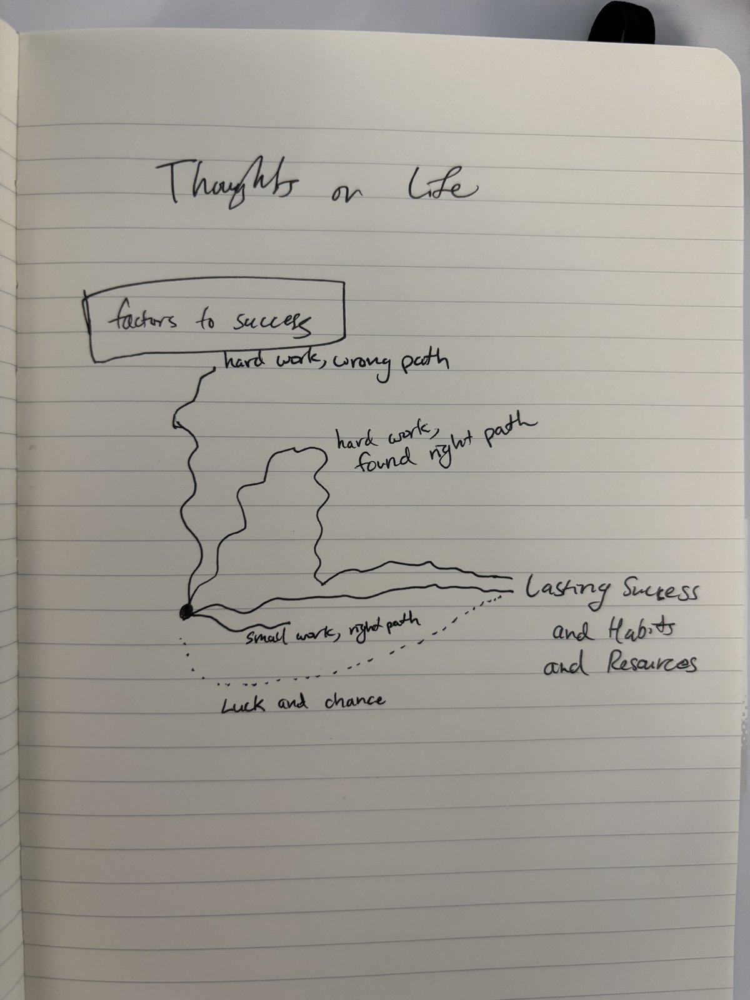

# Thoughts on Life: Three Factors to Success

## The three factors

The picture is built on three factors: **hard work**, a **splash of luck**, and the **right path**, meaning the direction your effort points. I'm not saying this is fully correct, and it's not every factor behind success in every situation. It's just one way of thinking about a common pattern in life, one paradigm among many. I still find it a strong one that comes up often: plenty of effort pointed the wrong way never arrives, while effort pointed the right way usually does, sometimes with a little luck carrying it the rest of the way.

## Another analogous way of thinking about it: a little boat

Picture a little rowing boat on a river. **Hard work is the rowing**: every stroke moves you a little. **The right path is pointing the boat downstream**: row upstream and you can work hard all day and end up where you started. **Luck is a gust of wind**: nice when it comes, but you can't steer by it. Rowing hard in the right direction gets you there, rowing hard in the wrong direction just makes you tired, and sometimes the wind helps someone who barely rowed, and that's fine too.
